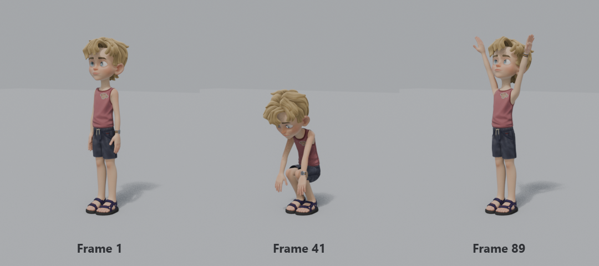
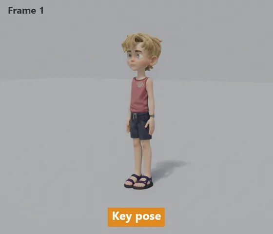
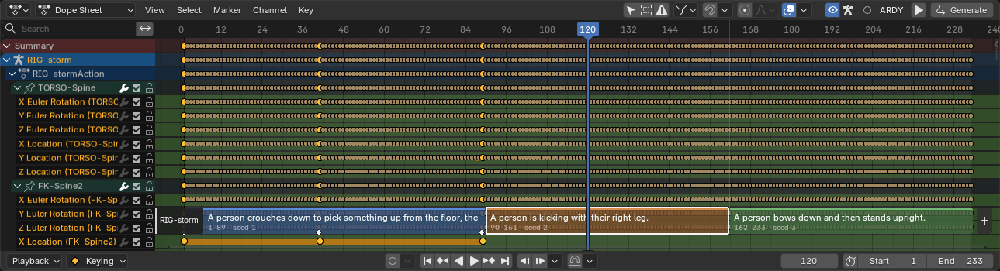
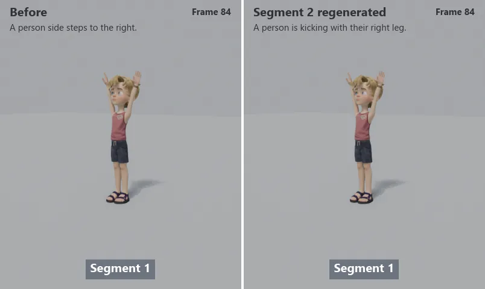

# Interpose

**Pose your own rig at a few key frames, write what the character does, and an AI motion model generates the movement in between. The result comes back as ordinary keys on your rig's own controls.**

Interpose is a Blender extension for animators. You keep your rig, its controls and your key poses; a motion model (NVIDIA's ARDY or Kimodo for now, others can be added) generates the in-betweens from a text prompt, and you edit the result like any other animation. Rigify, Auto-Rig Pro and CloudRig rigs, and skeletons such as Mixamo characters, work without any setup; other rigs are set up once.

> **Status:** 0.1.1. Tested on Windows 11 with an NVIDIA RTX 3090. Feedback and bug reports are welcome on the [issues page](https://github.com/Maxiriton/interpose/issues).

**1. Pose the character on a few frames**, with the rig's own controls.

**2. Write what it does and click Generate.** Here: *"A person crouches down to pick something up from the floor, then stands up and raises both arms above their head."* The motion between the key poses comes back as keys on the rig's controls, and the key poses stay exactly as you made them.

**3. Go on with more prompts.** Each prompt is a segment, drawn as a band under the keys in the Dope Sheet, the Timeline and the Graph Editor, and edited with the mouse like NLA strips. Your key poses are the large keys; the small ones are **Generated** keys.

**4. Regenerate one segment** with another prompt or seed: only its frames change, and the model joins them to the motion around it.

Character: [Storm](https://studio.blender.org/characters/storm) by Blender Studio ([CC-BY 4.0](https://creativecommons.org/licenses/by/4.0/)), rigged with CloudRig. Motion generated by ARDY.

## Features

- **Your keys are never overwritten.** The result comes as **Generated** keys; a generated key you edit becomes yours. The model runs in its own process: Blender never freezes and never loads the model itself.
- **Your own rig**: the motion is written on its controls. Limbs you posed in IK stay in IK: their IK controls follow the generated motion.
- **Any key poses**: two or more, one, or none at all (the prompt alone). A key pose can be partial: key only a hand, and the rest of the body is generated around it.
- **Prompt segments**: a track of prompts per character ("walks forward" for 3 s, then "turns and waves"...). Generate the whole track with the model's own transitions, or regenerate one segment alone.
- **Rig setup**: Rigify, Auto-Rig Pro and CloudRig rigs and skeletons (Mixamo, Unreal, SMPL, VRM, Daz, Character Creator...) set themselves up. Others are set up by picking their bones, and **Check Rig** tests what the controls really do.
- **Models installed for you** from the add-on's preferences (their Python, packages and weights), with a check that gives a fix for each problem.
- **Several characters per scene**, each with its own prompt, segments and settings.

---

- [Requirements](#requirements)
- [Installing the extension](#installing-the-extension)
- [Installing a model](#installing-a-model)
- [Setting up a rig](#setting-up-a-rig)
- [Generating the in-betweens](#generating-the-in-betweens)
- [Prompt segments](#prompt-segments)
- [Writing prompts](#writing-prompts)
- [Limits](#limits)
- [Troubleshooting](#troubleshooting)
- [Files from older versions](#files-from-older-versions)
- [Licences](#licences)
- [For developers](#for-developers)

## Requirements

- **Blender 5.2** or newer.
- **To generate**: an **NVIDIA GPU** with enough video memory, and disk space for the model. macOS can't generate (no NVIDIA GPUs); Linux should work but isn't tested yet. The rig setup works everywhere.
- An internet connection for the install, and Blender's **Allow Online Access** on (**Edit > Preferences > System > Network**).

| Model | Video memory | Disk | Also needs |
|---|---|---|---|
| **ARDY** (the default), 8-bit text encoder | about 9.5 GB | about 15 GB | Visual Studio's C++ build tools on Windows (a C++ compiler elsewhere) for its post-processing; optional |
| **ARDY**, 4-bit text encoder | about 6.2 GB | about 12 GB | the same |
| **Kimodo** | about 8 GB | about 12 GB | |

The **text encoder** (the part reading your prompt: Llama 3 8B) takes most of the video memory: it decides which model fits your GPU. The preferences show what each setting needs next to your GPU's memory, and pick ARDY's text encoder for your GPU until you choose one.

## Installing the extension

1. Download `interpose-<version>.zip` from the [Releases page](https://github.com/Maxiriton/interpose/releases). Don't unzip it.
2. In Blender, open **Edit > Preferences > Get Extensions**, click the arrow in the top right corner, then **Install from Disk...**, and choose the zip.
3. Interpose is enabled. Its panels are in the 3D Viewport's sidebar (`N`), in the **Interpose** tab; the animation editors' headers get its buttons too.

To update, install the new zip the same way. Your models stay installed.

## Installing a model

The extension contains no model: it installs the one you choose, on your request, from its official sources. In **Edit > Preferences > Add-ons > Interpose**, choose the model in **Backend** (ARDY by default): its settings and setup are shown below it, with what it supports (text prompt, key poses, prompt segments, longest motion...). One model is loaded on the GPU at a time.

1. **Check the video memory line** under the model's settings ("Needs about 9.5 GB of video memory, the GPU has 24 GB"). With ARDY, choose its text encoder first, **8-bit** or **4-bit**: one marked with a warning icon doesn't fit your GPU. You can still install it (the install dialog warns), but the model may fail to load or run very slowly.
2. Click **Install**. A dialog shows what it downloads, from where, how much, and the licences: read them, they apply to you (see [Licences](#licences)). Confirm.
3. The install runs in the background with its progress, a few minutes for several GB: its own Python and environment (with [uv](https://github.com/astral-sh/uv), downloaded once), its packages (the right PyTorch build for your GPU), its weights. **Cancel** stops it; **Resume Install** goes on where it stopped, after a failure too.
4. **Check Setup** says what is ready and what isn't, each problem with its fix: the environment, the packages, the GPU (PyTorch can use it, enough video memory), the weights.

**The models:**

- **ARDY** (NVIDIA, the default): generates window by window (2 s at a time), with no length limit, at 30 fps, about a second for 5 s once loaded. **Text Encoder**: **8-bit** (9.5 GB of video memory in all, loads in a few seconds) or **4-bit** (6.2 GB, the motion a little further from the full encoder's). Without a C++ compiler it installs without its post-processing, and follows the key poses less exactly: install Visual Studio's C++ build tools (the "Desktop development with C++" workload), then **Repair**.
- **Kimodo** (NVIDIA): generates up to 10 s per prompt, at 30 fps, in about 3 s once loaded. Installed from [Aero-Ex's fork](https://github.com/Aero-Ex/kimodo), which runs on Windows without a compiler and comes with a 4-bit text encoder (no gated weights).
- **Developer** (at the bottom of the preferences) also shows the variants kept for comparisons: Kimodo's v1 model, ARDY's Core checkpoint (its own 27-joint skeleton, 20 fps) and its **Full** text encoder (16.5 GB, a minute to load, gated).
- After changing a model's setting, or updating the add-on, the header may say **Weights missing** or **Packages missing**: **Install** gets them (seconds when the weights are already there).

**Where things go:**

- **Models Folder**: where the environments go. Empty: `%LOCALAPPDATA%\Interpose` on Windows, `~/.local/share/interpose` on Linux. Choose another drive if yours is short of space.
- Weights from Hugging Face go to its usual cache (`~/.cache/huggingface`), shared with your other tools: weights already there aren't downloaded again.
- **Existing Environment**: use a Python environment where the model is already installed (its Python executable), instead of installing it.
- **Remove** (the bin) deletes the model's environment and the weights installed with it, and its weights in the Hugging Face cache if you tick it, unless another model needs them. **Repair** makes the environment again and completes the weights.

**Gated weights (Hugging Face sign-in).** No model needs an account by default. Only ARDY's **Full** text encoder (shown with **Developer**) uses Meta's Llama 3 8B Instruct as Meta publishes it, which you must ask access to:

1. Make a Hugging Face account, request access on [Llama 3's page](https://huggingface.co/meta-llama/Meta-Llama-3-8B-Instruct) (**Request Access** in the check opens it), and wait for it to be granted.
2. Click **Sign In**: a terminal opens running Hugging Face's own sign-in. Sign in there yourself (from the browser, or with a token you paste there).
3. **Install** again.

The add-on never asks for, reads, stores or sends your token: Hugging Face's library uses your sign-in by itself.

## Setting up a rig

Select your character's armature: the active armature is the character Interpose works on. For most rigs that's all: its **rig profile** is set up as soon as it is selected (the Generate panel says how). When it isn't, the animation editors' header says so in place of **Generate** ("rig not set up", "rig setup incomplete", "the rig check failed"), with **Set Up Rig...**, which opens the **Rig Setup** panel right there; the same panel is in the 3D Viewport's sidebar (`N`, Interpose tab).

- **Recognized rigs**: **Rigify**, **Auto-Rig Pro** and **CloudRig** get their preset, with their FK controls, IK/FK switches and IK snap.
- **Skeletons** animated directly, without controls (Mixamo, Unreal's mannequin, SMPL, VRM, Daz, Character Creator, a mocap or BVH import...), are recognized from their bone names and hierarchy. An FBX import standing Y-up, or a skeleton facing +Y, is fine.
- **Other rigs**: the **Rig Setup** panel maps the rig to humanoid roles (hips, spine, head, upper arm, forearm, hand, thigh, shin, foot...), listed by body part, each one found, missing or optional. **Detect Bones** finds what it can; for the rest, pick the role's bone in the viewport (Pose Mode) and click the role's **eyedropper**. Required roles: hips, at least one spine bone, head, upper arms, forearms, hands, thighs, shins and feet.
  - **Separate Controls**, on a controller rig: each role has a bone to **read** (on Rigify, the `ORG-` bone, the result of FK and IK) and a control to **write** (on Rigify, the FK control).
  - **IK/FK Limbs** (sub-panel): for each limb, its FK controls, its IK/FK switch property, and how each IK control follows the generated motion (**IK snap**: **Follow** a bone, **Pole** in the limb's plane, **Rest**). A limb without IK snap stays in FK after generating. **Snap FK to IK** snaps the FK controls onto the IK pose on frames you list.
  - **Advanced** (sub-panel): per role, Use Translation and the offset mode (**Roll** copies the bone's direction: arms and legs; **Offset** the rotation from rest: spine, neck, head, feet).
  - The menu next to **Check Rig**: **Load Preset**, **Import Profile** / **Export Profile** (JSON, to reuse a profile on a similar rig), **Add Roles**.
- **Check Rig** tests the profile from the rig's rest pose: each written control is turned (its read bone must turn with it), each IK/FK limb is switched both ways (it must stay where it was). The pose is put back and nothing is keyed. Problems are listed in the panel; **Generate** runs the check itself the first time a profile is used, and an error stops it.
- The profile is stored on the armature data: objects sharing the armature share it, and it travels with a rig linked from a library. Set it up in the rig's own file; in a shot that links the rig, it is read-only (to change it in one shot only, override the armature data too: `rig.data = rig.data.override_create(remap_local_usages=True)`).

## Generating the in-betweens

1. **Select the character** and enter **Pose Mode**: the animation editors' header shows **Generate** once the rig is set up, and says what's missing otherwise.
2. **Key your poses** with the rig's controls. Any keyframe type works except **Generated** (Keyframe, Breakdown, Extreme...). A frame is a key pose as soon as one of the profile's controls has a key there.
3. In the **Generate** panel (or the animation editors' header), write a **prompt**, what the character does ("A person walks forward and waves"; see [Writing prompts](#writing-prompts)), and choose a **seed**.
4. Click **Generate**. The panel and the status bar show the progress: the model's own steps, then the keys being written. **Esc** or the cancel button stops it until the keys are being written (a few seconds; Blender stays responsive, you can look around but not edit).

The result is written on the rig's controls as **Generated** keys, on every frame between your first and last key pose, and the generation becomes **prompt segment 1**, a band in the timeline. Frames carrying one of your keys are never written; generating again replaces the Generated keys and keeps yours. The whole generation is one undo step.

The first generation starts the model (about 20 s; the header says **Starting**, then **Loading**). The model then stays loaded: the next generations take about 3 s with Kimodo and under a second with ARDY, plus the time to write the keys (on Rigify about 1 s for 120 frames, as much again for the limbs in IK, more on a character whose meshes are heavy to deform). **Start** / **Stop** load the model ahead of time, or free the GPU.

- **Range**: **Key Poses** (the default) goes from the first key pose to the last. **Custom** sets a start frame and a duration: generate from the **prompt alone** with no key pose (the motion starts where the character stands on the start frame, facing where it faces; on Rigify move or turn the **root** control), start from **one key pose** or end on one, or **extend** an animation past its last key pose. Key poses outside the range are ignored and never touched.
- **Limbs in IK** stay in IK. The motion is written to the FK controls: on each key pose, the FK controls of a limb in IK are first snapped to its IK pose (keyed as normal keys); then its IK controls (hand, foot, pole...) follow the generated motion on every frame, as Generated keys, and the IK/FK switch goes back to what you left. Pose the limb in IK anywhere, and that frame is a key pose for the next generation. Your IK keys are kept.
- **Partial key poses**: a frame where you keyed only some controls (an arm, a foot...) pins only what you keyed: the hand or foot lands where your pose puts it (and the hips, always pinned on a constrained frame); keying the spine, the neck or the head pins the whole body. The rest of that frame is generated, and your keys stay as they are. Your keys are FK rotations, so if the generated body moves a lot there, the hand can land away from where you posed it: key the body as well to keep the whole pose.
- **Editing a Generated key makes it yours**: as soon as you change one (move it, or key over it after posing the rig), it becomes a **Keyframe**, and the next generation uses it as a key pose. Cancel the move (right click) and it goes back to Generated. **Key > Keyframe Type** promotes a key without changing it.
- **Clear Generated Keys** (Generate panel, Interpose menu) removes what the add-on put on the character: its Generated keys, and the keys it made on your key poses (FK controls snapped to your IK pose, IK controls, an IK/FK switch keyed in FK), even on protected bone collections. A key it made that you changed since is yours, and stays. A control left without keys goes back to its rest pose. One undo step.
- Scene frame rates other than the model's are handled: the key poses land exactly on the model's frames and the result is resampled. A character facing any direction, anywhere in the scene, works.
- The model's skeleton is added to the scene as a hidden armature, in an **Interpose Models** collection, next to your character.

## Prompt segments

A character can follow several prompts one after the other: "walks forward" for 3 s, then "turns left and waves" for 2 s... Each **segment** has a start, an end, a prompt and a seed. Segments follow each other with no gap, like a track; your key poses stay constraints inside them.

- **The first generation makes segment 1**; **Add Prompt Segment** (the **+** in the Generate panel) makes it before generating too, and adds the next ones at the end of the track (2 s, no prompt yet). The panel shows the **active** segment (its prompt, seed, start and end); the arrows go to the previous or next one; **−** removes it (the one before takes its frames); the split button cuts the segment under the current frame in two.
- **The bands** at the bottom of the **Dope Sheet**, the **Timeline** and the **Graph Editor** show the panel's character (before its first segment, a band with only its name and a **+** to add one), then the other selected characters with segments. A band shows each prompt, its frames and seed, your key poses (small diamonds) and the transitions. A hatched segment hasn't been generated, or was edited since. **View > Show Prompt Segments** (or the eye in the header) hides them.
- **With the mouse**, like NLA strips: **click** a segment to make it active (a click on a name makes that character the panel's), **drag** a boundary to move it (the neighbour adapts) or drag a segment to move both its boundaries; **Esc** or a right click cancels. **Double click** opens the segment's prompt, seed and frames; **right click** opens its menu: Edit, Split at Current Frame, Add, Remove, Regenerate Segment, Generate Whole Track. **+** after the track adds a segment. Each change is one undo step.
- **The animation editors' header** shows the model's state (with a start button when it isn't loaded) and **Generate**, or the progress bar and its cancel button while generating. The **Interpose** menu next to it has the rest: generate, regenerate the active segment, edit, add, split or remove a segment, Clear Generated Keys, start or stop the model, its errors, the preferences.
- **Generate** in the header (or **Generate Whole Track**) generates the whole track at once, with the model's own transitions between the segments. Each segment lasts 0.5 s at least. Kimodo generates up to 10 s per segment, the track can be longer; ARDY changes prompt at each boundary, with no length limit.
- **Regenerate Segment** (the segment's menu, its popup, the Interpose menu, the Generate panel) generates one segment again, with its own prompt and seed, and leaves the rest of the track as it is: only the segment's frames get new Generated keys, in one undo step. The model joins the motion around it, so there is no jump at its boundaries. A neighbour never generated (hatched) isn't joined: generate it afterwards, or the whole track. To regenerate between two key poses, split the track there first.

## Writing prompts

Kimodo and ARDY learned from the same motion capture descriptions ([BONES-SEED](https://huggingface.co/datasets/bones-studio/seed)): prompts written like them work best. This follows NVIDIA's own advice for Kimodo.

- **Start with "A person..."**, in English. The subject can carry the style: "An old person...", "A tired person...", "A drunk person...".
- **One or two actions per prompt.** For a sequence of actions, use one prompt segment for each.
- **A medium level of detail.** "A person walks." is too vague, and a description of every limb is more than the model can follow.
- **What the models know**: walking and running, gestures, everyday actions, common objects, video game combat, dancing, and styles such as tired, angry, happy, sad, scared, drunk, injured, stealthy, old or childlike. A specific sport move (a baseball swing) won't come out well.
- **Each segment's prompt on its own.** The model doesn't read the previous segment's prompt: write "A person walking carrying a box comes to a stop", not "Then they stop".
- **Agree with your key poses.** A prompt that contradicts them ("jumps" between two poses standing on the same spot) gives a worse motion: the model has to choose between them.

Examples from ARDY's own demo: "A person is walking backwards.", "A person side steps to the right.", "A person is kicking with their right leg.", "A person bows down and then stands upright.", "A young lady walks forward elegantly.". In the same style: "A person picks up a box from the floor with both hands.", "A tired person walks slowly, dragging their feet.", "A person sneaks forward, crouching, looking around.".

## Limits

- **Fingers are not generated.** Kimodo and ARDY animate SOMA's 30-joint body; the fingers of their 77-joint output are a fixed relaxed pose. The add-on doesn't map fingers, so they keep your own animation (key them as you like, before or after generating).
- **NVIDIA GPUs only** for generating; Windows tested, Linux not yet; no macOS.
- **Humanoid characters only**: two arms, two legs, a spine and a head. Quadrupeds and props aren't generated.
- **Limbs posed in IK only**, with no FK control to write and no IK/FK switch (some older hand-made rigs), aren't supported: **Check Rig** names them.
- **Rigify's IK limbs are a little shorter than its FK ones**, so in IK the elbows and knees can sit 1 or 2 cm from the generated motion, and a knee doesn't fully straighten (where the generated leg straightens, it stays bent a few cm and can pop forward). Hands and feet follow the motion.
- Kimodo generates at most **10 s per prompt** (per segment with prompt segments).
- **One model on the GPU at a time**: choosing another one stops the previous one.
- The keys can't be written faster than Blender evaluates the rig on each frame: on a character with heavy meshes, writing takes longer than generating.

## Troubleshooting

- **The header says "not set up", "Weights missing" or "Packages missing"**: open the preferences, **Check Setup**, and follow the fix shown for each problem (usually **Install** or **Repair**).
- **The install fails right away**: Blender's **Allow Online Access** must be on (Preferences > System > Network). Look at the install log (the log button next to the model); **Resume Install** goes on where it stopped.
- **The check says a gated repository needs access, or that the sign-in expired**: request access on the repository's page, then **Sign In** (see [Installing a model](#installing-a-model)), then **Install** again.
- **Not enough video memory**: close other applications using the GPU, stop the other model, generate a shorter range, or choose ARDY's 4-bit text encoder (then **Install**: it downloads that encoder).
- **The model says its weights are missing or damaged, or its environment is missing a package**: **Check Setup** in the preferences, and follow its fix (usually **Repair**). The message's second line is the model's own error, for a bug report.
- **The check says PyTorch can't use the GPU**: update the NVIDIA driver. An RTX 50 series GPU gets a PyTorch build for it (CUDA 12.8) at the install; after changing the GPU, **Repair**.
- **Generate says the rig has a problem**: the Rig Setup panel lists what **Check Rig** found, each with its role. Fix the profile, or the rig, and run **Check Rig** again.
- **The character doesn't move, or only some limbs move**: check that the profile's roles are found (Rig Setup panel) and that your key poses are on the profile's controls. On Rigify, a limb in IK whose IK/FK switch is animated between key poses needs a key pose on the frames where it switches.
- **A pose came out wrong on one frame**: key that frame yourself (it becomes a key pose), or regenerate the segment with another seed.
- **The model doesn't start**: the Interpose menu in the animation editors shows its last errors; the console (Window > Toggle System Console on Windows) has the details. Please include them in a bug report.

## Files from older versions

Files saved when the add-on was called **Retargetor** are brought up to date when opened (save them again with Interpose); a rig linked from a library gets it when its own file is opened and saved. The manual bone list of the first versions (the Retarget panel, removed in 0.1.0) is no longer used.

## Licences

**Interpose** is free software under the [GNU General Public License, version 3 or later](LICENSE) (GPL-3.0-or-later).

**The extension contains no model and no weights.** When you click **Install**, it downloads them on your machine from their official sources, and **each one comes with its own licence, which applies to you** as its user; the install dialog lists them with their links. In short (this is not legal advice; read the licences themselves):

| Component | Source | Licence |
|---|---|---|
| Kimodo code | [nv-tlabs/kimodo](https://github.com/nv-tlabs/kimodo), installed from [Aero-Ex's fork](https://github.com/Aero-Ex/kimodo) | Apache-2.0 |
| Kimodo weights (SOMA-RP v1, v1.1) | [NVIDIA on Hugging Face](https://huggingface.co/nvidia/Kimodo-SOMA-RP-v1.1) | [NVIDIA Open Model License](https://www.nvidia.com/en-us/agreements/enterprise-software/nvidia-open-model-license/) |
| ARDY code | [nv-tlabs/ardy](https://github.com/nv-tlabs/ardy) | Apache-2.0 |
| ARDY checkpoints (SOMA, Core) | NVIDIA on Hugging Face | [NVIDIA Open Model License](https://www.nvidia.com/en-us/agreements/enterprise-software/nvidia-open-model-license/) |
| Text encoders: LLM2Vec on Meta Llama 3 8B Instruct, and its 4-bit and 8-bit builds (Aero-Ex, voxta) | [Meta](https://huggingface.co/meta-llama/Meta-Llama-3-8B-Instruct), [McGill-NLP](https://huggingface.co/McGill-NLP/LLM2Vec-Meta-Llama-3-8B-Instruct-mntp), Hugging Face | [Meta Llama 3 Community License](https://huggingface.co/meta-llama/Meta-Llama-3-8B-Instruct/blob/main/LICENSE) and Meta's Acceptable Use Policy |
| uv (installs the models' Python and packages) | [astral-sh/uv](https://github.com/astral-sh/uv), from PyPI | MIT or Apache-2.0 |
| PyTorch and the other Python packages | PyPI, PyTorch's index | their own licences (BSD, MIT, Apache-2.0...) |

What this means:

- **NVIDIA Open Model License**: the models can be used commercially; NVIDIA claims no ownership of the motions you generate, and you are responsible for how you use them. Bypassing a model's safety mechanisms ends the licence. Kimodo's SMPL-X variant, under NVIDIA's research-only licence, is not used.
- **Meta Llama 3 Community License**: commercial use is allowed (a company with more than 700 million monthly users needs Meta's agreement); its Acceptable Use Policy applies; Llama 3 and its outputs can't be used to improve another large language model. Here it only turns your prompt into the model's text features.
- The motions you generate are yours to use, within those licences.

**Built with Meta Llama 3.**

The images in this README show [Storm](https://studio.blender.org/characters/storm), a character by Blender Studio under [CC-BY 4.0](https://creativecommons.org/licenses/by/4.0/); they are kept in `docs/` and are not part of the extension.

## For developers

The add-on's code is plain Python; the models run in worker processes with their own Python and talk to Blender over JSON lines, so a new model is a folder in `backends/` (see `backends/base.py`). [CLAUDE.md](CLAUDE.md) describes each file and the architecture rules, [ROADMAP.md](ROADMAP.md) the phases and decisions, [DESIGN.md](DESIGN.md) the data model.

- Tests: `python tests/run_tests.py` (see the file for its arguments: the spike outputs, a Kimodo environment, real rigs).
- The core can be used from scripts, without the scene properties: `core.retarget.snap.Retargeter(source, target, pairs, translation_scale)` snaps (`snap_pose`) or bakes (`bake(scene, view_layer, frames)`) a list of `BonePair`s from one armature to another, and `core.profile.compose(profile, joint_map, direction)` builds those pairs from a rig profile and a skeleton's role → joint map.
- Package: `blender --command extension build` in the repository's folder.

## Author

Henri Hebeisen
